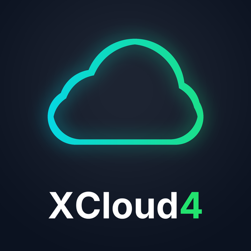

# XCloud4

  

**XCloud4** es un cliente nativo e independiente de Xbox Cloud Gaming para consolas PlayStation 4 con GoldHEN, compilado con OpenOrbis PS4 Toolchain.  
**XCloud4** is an independent, native Xbox Cloud Gaming client for PlayStation 4 consoles running GoldHEN, built with the open-source OpenOrbis PS4 Toolchain.

> **Misión / Mission:** Que más personas puedan jugar títulos de nueva generación sin comprar una consola nueva. / Helping more people play next-gen games without buying a new console.

---

## Aviso / Disclaimer

**Aviso:** XCloud4 es un proyecto independiente, sin afiliación con Microsoft, Xbox ni Sony. Se ofrece tal cual, sin garantías. Lo usas bajo tu propia responsabilidad: el proyecto no se hace responsable de problemas con tu consola, tu cuenta o tus suscripciones. Usa XCloud4 respetando los términos de servicio de Microsoft y Xbox.

**Disclaimer:** XCloud4 is an independent project, not affiliated with Microsoft, Xbox or Sony. It is provided as is, without warranty. You use it at your own risk: the project is not responsible for problems with your console, account or subscriptions. Use XCloud4 in accordance with Microsoft and Xbox terms of service.

---

## Novedades de la 1.3.0-beta / What's New in 1.3.0-beta

### Español
- **Nueva interfaz completa:** barra lateral con Inicio, Descubrir, Catálogo, Mis juegos, Buscar y Ajustes, con diseño moderno y soporte de carátulas y capturas.
- **6 idiomas compatibles:** Español, English, Português (Brasil), Français, Italiano y Deutsch.
- **Hasta 4 mandos locales:** multijugador local en la nube asignando mandos a distintos usuarios de la PS4 (Ajustes → Mandos).
- **Micrófono opcional:** chat de voz en juegos compatibles con auriculares reconocidos por la PS4 (Ajustes → Micrófono).
- **Reconexión y recarga:** reconexión automática ante pérdidas de conexión y opción «Recargar transmisión» en el menú de partida (touchpad con dos dedos 1 s).
- **Mejor calidad y rendimiento:** conversión de color por GPU, sincronía vertical por defecto (sin cortes ni tearing) y calidad «1080p Máxima» para cuentas Ultimate.
- **Sesión persistente y TLS propio:** opción de recordar inicio de sesión en la PS4 y conexión segura integrada para compatibilidad amplia de firmwares.
- **Actualizaciones desde la app:** descarga directa del paquete firmado a `/data/pkg` con aviso guiado para su instalación manual con GoldHEN Package Installer.
- Consulta [RELEASE_NOTES_1.3.0-beta.md](RELEASE_NOTES_1.3.0-beta.md) para todos los detalles. Para la edición de laboratorio, consulta [RELEASE_NOTES_lab-0.7.111.md](RELEASE_NOTES_lab-0.7.111.md).

### English
- **Complete new interface:** sidebar navigation with Home, Discover, Catalog, My games, Search, and Settings, featuring rich artwork and screenshots.
- **6 supported languages:** Español, English, Português (Brasil), Français, Italiano, and Deutsch.
- **Up to 4 local controllers:** local multiplayer on cloud sessions by binding controllers to separate PS4 user profiles (Settings → Controllers).
- **Optional microphone:** voice chat in supported games using headsets recognized by the PS4 (Settings → Microphone).
- **Reconnection and reload:** automatic recovery on transient network drops, plus a "Reload stream" action in the in-game menu (two fingers on touchpad for 1 s).
- **Improved visuals and performance:** GPU-accelerated color conversion, VSync on by default (no tearing band), and a "1080p Max" profile for Ultimate accounts.
- **Persistent sign-in and built-in TLS:** optional session persistence and a standalone TLS stack for wide firmware compatibility.
- **In-app update downloads:** downloads hash-verified signed release packages to `/data/pkg` with instructions for manual installation via GoldHEN Package Installer.
- See [RELEASE_NOTES_1.3.0-beta.md](RELEASE_NOTES_1.3.0-beta.md) for full details. For the laboratory edition, see [RELEASE_NOTES_lab-0.7.111.md](RELEASE_NOTES_lab-0.7.111.md).

---

## Requisitos / Requirements

### Español
- **Consola:** PS4 con **GoldHEN**.
  - **Probado en:** PS4 Fat, firmware 12.00, GoldHEN v2.4b18.7. Si la usas en otro modelo o firmware, cuéntanos en un issue si funciona.
- **Cuenta / Suscripción:** Game Pass con juego en la nube (PC Game Pass no lo incluye), o una cuenta gratuita de Microsoft con perfil de Xbox para Fortnite.
- **Red:** Conexión estable de **15 Mbps o más** (mejor por cable Ethernet).

### English
- **Console:** PlayStation 4 running **GoldHEN**.
  - **Tested on:** PS4 Fat, firmware 12.00, GoldHEN v2.4b18.7. If you use it on another model or firmware, let us know in an issue whether it works.
- **Account / Subscription:** An Xbox Game Pass plan that includes cloud gaming (PC Game Pass does not), or a free Microsoft account with an Xbox profile for Fortnite.
- **Network:** A stable internet connection of **15 Mbps or more** (wired Ethernet recommended).

---

## Ediciones / Editions

Ambas ediciones se compilan desde este mismo árbol de código (`X4_PUBLIC=1` y `X4_PUBLIC=0`) y usan Title IDs e iconos distintos para poder instalarse a la vez en la misma consola:

| Edición / Edition | Paquete / Package | Título en PS4 | Title ID | Público objetivo / Target Audience |
|---|---|---|---|---|
| **Public Beta** | `XCloud4-1.3.0-beta-publico.pkg` | `XCloud4` | `XCLD00003` | Jugadores: interfaz moderna completa, 6 idiomas, soporte hasta 4 mandos, micrófono opcional, reconexión y recarga, conversión de color por GPU, calidad hasta 1080p Máxima, sesión persistente opcional y descarga de actualizaciones. |
| **Experimental Lab** | `XCloud4-0.7.111-lab.pkg` | `XCloud4 Lab` | `XCLD00001` | Pruebas avanzadas: añade motor de scripts Lua para DualShock 4 (curvas de sticks, giroscopio y accesibilidad), panel de telemetría en tiempo real `R3` y registros diagnósticos en `/data/xcloud4/`. |

Consulta [RELEASE_NOTES_1.3.0-beta.md](RELEASE_NOTES_1.3.0-beta.md) y [RELEASE_NOTES_lab-0.7.111.md](RELEASE_NOTES_lab-0.7.111.md) para más detalles.

---

## Instalación y actualizaciones / Installation and Updates

### Primera instalación / Initial Installation
1. Descarga `XCloud4-1.3.0-beta-publico.pkg` (o `XCloud4-0.7.111-lab.pkg` para la edición de laboratorio).
2. Copia el archivo `.pkg` a tu PS4 mediante:
   - Una **memoria USB** (FAT32 o exFAT) en la raíz, o
   - El servidor **FTP de GoldHEN** en `/data/pkg/`.
3. En la PS4, abre **GoldHEN > Package Installer** (o **Debug Settings > Package Installer**) e instala el paquete.
4. Abre **XCloud4** desde el menú de la PS4 e inicia sesión desde tu teléfono o PC con el código o QR en pantalla (`microsoft.com/link`).

### Actualizar desde la app / In-App Updates
- Al publicarse una versión nueva, XCloud4 avisará en Inicio y en **Ajustes → Acerca de → Buscar actualizaciones**.
- Al seleccionar **Actualizar ahora**, la app descarga el paquete firmado desde GitHub a `/data/pkg/` y verifica su firma digital.
- Para completar la actualización en la consola: pulsa el **botón PS → Ajustes → GoldHEN → Package Installer** e instala el paquete descargado.

---

## Idiomas disponibles / Supported Languages

XCloud4 incluye traducción completa en 6 idiomas:
- **Español** (Spanish)
- **English** (Inglés)
- **Português (Brasil)** (Portuguese - Brazil)
- **Français** (French)
- **Italiano** (Italian)
- **Deutsch** (German)

Por defecto, la interfaz detecta automáticamente el idioma de tu consola PS4. Puedes cambiarlo en cualquier momento desde **Ajustes → Interfaz → Idioma** (**Settings → Interface → Language**).

---

## Controles / Controls

### En los menús y el catálogo / Outside of Game

| Control | Acción (ES) | Action (EN) |
|---|---|---|
| **D-Pad / Stick Izquierdo** | Navega por tarjetas, menús y opciones | Navigates cards, menus, and options |
| **X (Cruz)** | Selecciona / Abre el juego o menú | Selects / Launches game or opens menu |
| **CÍRCULO** | Vuelve atrás / Cierra el panel | Goes back / Closes modal or panel |
| **L1 / R1** | Cambia de sección o pestañas | Switches sections or tabs |
| **OPTIONS** | Abre Ajustes rápidos | Opens quick settings |

### En el juego (mientras juegas en la nube) / In-Game Menu

| Control | Acción (ES) | Action (EN) |
|---|---|---|
| **Dos dedos 1 s en el touchpad** | Abre el menú del juego | Opens the in-game menu |
| **Arriba / Abajo** | Navega por las opciones (`Volver al catálogo`, `Recargar transmisión`, `Silenciar/Activar micrófono`, `Botón Xbox`, `Cancelar`) | Navigates menu options (`Return to catalog`, `Reload stream`, `Mute/Unmute microphone`, `Xbox button`, `Cancel`) |
| **X (Cruz)** | Confirma la opción elegida | Confirms highlighted option |
| **CÍRCULO** | Cierra el menú y vuelve al juego | Closes menu and returns to game |
| **Click del touchpad** | Botón **Vista** de Xbox | **Xbox View** button |
| **OPTIONS** | Botón **Menú** (Start) de Xbox | **Xbox Menu** (Start) button |

### Salir de la aplicación / Exiting the Application

- Para salir en cualquier momento: **botón PS > Cerrar aplicación** (`PS button > Close Application`).

---

## ¿Por qué no me funciona? / Troubleshooting

> **Recordatorio / Reminder:** Consulta el [Aviso / Disclaimer](#aviso--disclaimer) al inicio de este documento.  
> **País de acceso** declara otro país únicamente al iniciar la sesión en la nube, mediante una cabecera de la petición de acceso. Es opcional y no está garantizado: no da una suscripción ni cambia el país de la cuenta. No resuelve errores de perfil Xbox, país de la cuenta o edad que ocurran antes de ese acceso. Usar un país de acceso distinto puede ir contra los términos de Xbox y Microsoft podría restringir tu cuenta. Úsalo bajo tu propia responsabilidad.  
> **Access country** declares another country only when signing in to the cloud service, through a login request header. It is optional and not guaranteed: it does not provide a subscription or change the account's country. It does not resolve earlier Xbox profile, account-country or age errors. Using a different access country may go against Xbox's terms, and Microsoft could restrict your account. Use it at your own risk.

### Español
- **"Tu cuenta aún no tiene perfil de Xbox":** entra una vez en [xbox.com](https://www.xbox.com) con esa cuenta de Microsoft para crear tu perfil (gamertag) y vuelve a iniciar sesión en XCloud4.
- **Errores de DNS (`0x804101DC`–`0x804101EF`, `0x80410140`, `0x80410141`):** en la PS4 ve a **Ajustes > Red > Configurar conexión a Internet** y configura un DNS manual fiable (por ejemplo `1.1.1.1` / `8.8.8.8`).
- **"Xbox no envió imagen":** puede ser un fallo temporal de Xbox con ese juego o servidor; vuelve a intentarlo o prueba otro servidor en **Ajustes → Servidor**.
- **"Los servidores de Xbox están llenos. Estás en la fila…":** Xbox no tiene un servidor libre para ese juego en este momento (pasa a menudo con Fortnite en horas de mucha gente). Espera o cancela con CÍRCULO y vuelve a intentarlo.
- **"Xbox no tiene servidores libres ahora":** la fila superó los 15 minutos. Prueba en unos minutos o elige otro servidor en **Ajustes → Servidor**.
- **Posible restricción regional:** la tarjeta ofrece **País de acceso** y **X Probar acceso**, con el aviso de responsabilidad antes del primer país distinto de Automático. **TRIÁNGULO Más ayuda** conserva la guía. Un HTTP 403 también puede tener otras causas; consulta el código y la disponibilidad oficial en [xbox.com/regions](https://www.xbox.com/regions).

### English
- **"Your account doesn't have an Xbox profile yet":** sign in once at [xbox.com](https://www.xbox.com) with that Microsoft account to create your Xbox profile (gamertag), then sign in again in XCloud4.
- **DNS errors (`0x804101DC`–`0x804101EF`, `0x80410140`, `0x80410141`):** on your PS4, open **Settings > Network > Set Up Internet Connection** and set a working manual DNS (such as `1.1.1.1` / `8.8.8.8`).
- **"Xbox didn't send any video":** this may be a temporary Xbox issue with that game or server; try again or pick another server in **Settings → Server**.
- **"Xbox servers are busy. You're in line…":** Xbox has no free server for that game right now (common with Fortnite at peak hours). Wait, or cancel with CIRCLE and try again.
- **"Xbox has no free servers right now":** the queue went past 15 minutes. Try again in a few minutes or choose another server in **Settings → Server**.
- **Possible regional restriction:** the card offers **Access country** and **X Try access**, with the risk acknowledgement before the first non-Automatic country. **TRIANGLE More help** retains the guide. HTTP 403 can have other causes; check the code and official availability at [xbox.com/regions](https://www.xbox.com/regions).

¿Tu país no tiene Xbox Cloud Gaming? Lee [docs/region-es.md](docs/region-es.md)  
Your country doesn't have Xbox Cloud Gaming? Read [docs/region-en.md](docs/region-en.md)

---

## Idioma y región automáticos / Automatic Language and Region

XCloud4 detecta el idioma del sistema de la PS4 al arrancar mediante `sceSystemServiceParamGetInt(ORBIS_SYSTEM_SERVICE_PARAM_ID_LANG)`:
- **Idioma de la interfaz:** Se adapta automáticamente al idioma de la consola entre los 6 disponibles (Español, English, Português, Français, Italiano, Deutsch), con respaldo en inglés.
- **Región de tienda y sesión:** los textos y carátulas del catálogo siguen el idioma configurado en la consola (`es-ES`/`ES`, `es-MX`/`MX`, `en-US`/`US`, `en-GB`/`GB`, `pt-BR`/`BR`, `pt-PT`/`PT`, `fr-FR`/`FR`, `fr-CA`/`CA`, `de-DE`/`DE`, `it-IT`/`IT`, con respaldo en `en-US`/`US`).

---

## Misión, transparencia y apoyo / Mission, Transparency, and Support

- **Apoya el proyecto / Support:** Si XCloud4 te resulta útil, puedes apoyar su desarrollo con una donación voluntaria en [https://ko-fi.com/asapedgr](https://ko-fi.com/asapedgr). Las donaciones no dan acceso a juegos ni a servicios de Xbox.
- **Inicio de sesión con Microsoft / Microsoft Sign-In:** XCloud4 utiliza el flujo estándar OAuth 2.0 de código de dispositivo de Microsoft (`microsoft.com/link`) con el identificador público de cliente (`1f907974-e22b-4810-a9de-d9647380c97e`) empleado por clientes abiertos como GreenVita. Tu contraseña solo se introduce en la web oficial de Microsoft y los tokens permanecen en memoria RAM o cifrados en `/data/xcloud4/` solo si activas explícitamente la opción de recordar sesión.
- **Aviso de versiones / Update Check:** XCloud4 consulta una vez al arrancar la API pública de GitHub Releases para avisar de versiones nuevas; no envía datos de tu cuenta ni datos personales.

---

## Compilación y licencia / Building and License

- Las instrucciones para compilar ambos paquetes desde el código fuente están en [BUILDING.md](BUILDING.md).
- XCloud4 es software libre distribuido bajo la licencia **GNU General Public License v3.0 only (`GPL-3.0-only`)**. Consulta [LICENSE](LICENSE), [THIRD_PARTY_NOTICES.md](THIRD_PARTY_NOTICES.md) y [docs/licenses/](docs/licenses/).
