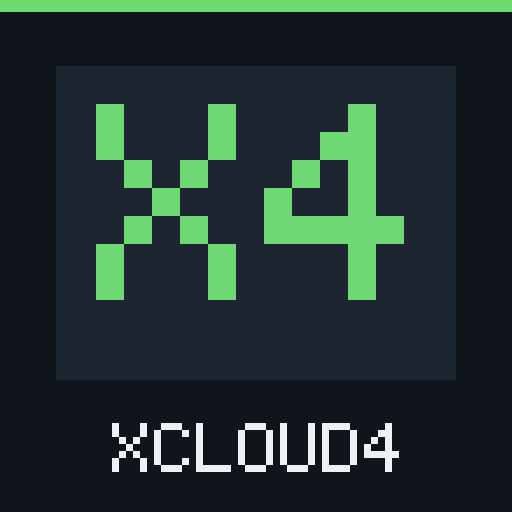

# XCloud4

  

**XCloud4** es un cliente nativo e independiente de Xbox Cloud Gaming para consolas PlayStation 4 con GoldHEN, compilado con OpenOrbis PS4 Toolchain.  
**XCloud4** is an independent, native Xbox Cloud Gaming client for PlayStation 4 consoles running GoldHEN, built with the open-source OpenOrbis PS4 Toolchain.

> **Misión / Mission:** Que más personas puedan jugar títulos de nueva generación sin comprar una consola nueva. / Helping more people play next-gen games without buying a new console.

---

## Aviso / Disclaimer

**Aviso:** XCloud4 es un proyecto independiente, sin afiliación con Microsoft, Xbox ni Sony. Se ofrece tal cual, sin garantías. Lo usas bajo tu propia responsabilidad: el proyecto no se hace responsable de problemas con tu consola, tu cuenta o tus suscripciones. Usa XCloud4 respetando los términos de servicio de Microsoft y Xbox.

**Disclaimer:** XCloud4 is an independent project, not affiliated with Microsoft, Xbox or Sony. It is provided as is, without warranty. You use it at your own risk: the project is not responsible for problems with your console, account or subscriptions. Use XCloud4 in accordance with Microsoft and Xbox terms of service.

---

## Novedades de la 1.2.1-beta / What's New in 1.2.1-beta

### Español
- **País de acceso opcional:** la tarjeta de posible restricción regional permite elegir un país y reintentar sin cerrar la sesión de Microsoft. También está en **OPTIONS > Acceso**; empieza en Automático y conserva la elección. No garantiza el acceso ni cambia el país de tu cuenta o el servidor de juego. Usar un país distinto puede ir contra los términos de Xbox y Microsoft podría restringir tu cuenta; úsalo bajo tu propia responsabilidad.
- **Aviso de actualización al abrir Inicio:** cuando la consulta existente detecta una versión nueva, muestra una tarjeta con QR a su release de GitHub, una vez por arranque y sin interrumpir otros paneles o partidas. CÍRCULO la cierra; el aviso verde y el estado en Acerca de permanecen.
- **Nueva interfaz, más rápida:** diseño oscuro renovado en todas las pantallas (menú principal, catálogo, búsqueda, Fortnite, Ajustes, Cuenta, Acerca de y Apoyo), menú de partida nuevo y pantalla de carga con un cohete animado.
- **Fila de Xbox:** si los servidores de Xbox están llenos, XCloud4 muestra que estás en la fila, el tiempo de espera y, si Xbox la da, una estimación. Espera hasta 15 minutos y puedes cancelar con CÍRCULO.
- **Menú OPTIONS con calidad, servidor y acceso:** pestañas **Imagen** (`1080p Alta`, `1080p` y `720p`), **Servidor** y **Acceso** (navegables con `L1`/`R1`).
- **Selector de servidor con ms reales de la última partida:** elige entre los servidores que Xbox ofrece a tu cuenta; tras jugar una partida en un servidor, XCloud4 guarda y muestra los ms reales medidos durante la sesión.
- **Botón Fortnite para cuentas sin Game Pass, con elección de calidad:** acceso directo desde el menú principal para jugar Fortnite gratis con una cuenta gratuita de Microsoft (con perfil de Xbox), eligiendo calidad y servidor antes de iniciar.
- **Imagen más nítida:** reconstrucción de color suave, escalado bilineal limpio de 720p a 1080p y realce de nitidez ligero.
- **Espera de hasta 30 s del primer vídeo con aviso de progreso:** mayor margen cuando Xbox tarda en iniciar el envío de vídeo.
- **Certificados propios para firmwares antiguos (sin confirmar en 5.05):** incluye raíces TLS actuales (DigiCert, Microsoft, USERTrust y Sectigo) para consolas con lista del sistema desactualizada (`0x8095F00C`).
- **Mensajes claros de cuenta, red y disponibilidad:** avisos traducidos para errores de perfil o región de Xbox, fallos de DNS/red y disponibilidad de Xbox Cloud Gaming.

### English
- **Optional access country:** the possible regional restriction card lets you choose a country and retry without signing out of Microsoft. It is also available in **OPTIONS > Access**; it starts on Automatic and remembers your choice. Access is not guaranteed, and it does not change your account's country or the game server. Using a different access country may go against Xbox's terms, and Microsoft could restrict your account; use it at your own risk.
- **Update notice on Home:** when the existing check finds a newer version, a card shows a QR to its GitHub release, once per launch and without interrupting panels or games. CIRCLE closes it; the green notice and About status remain.
- **New, faster interface:** refreshed dark design on every screen (main menu, catalog, search, Fortnite, Settings, Account, About and Support), a new in-game menu and a loading screen with an animated rocket.
- **Xbox queue:** when Xbox servers are full, XCloud4 shows that you're in line, how long you've waited and, when Xbox provides one, an estimate. It waits up to 15 minutes and you can cancel with CIRCLE.
- **OPTIONS menu with picture quality, server and access:** **Picture** (`1080p High`, `1080p`, and `720p`), **Server** and **Access** tabs (switchable with `L1`/`R1`).
- **Server selector with real ms from the last game:** pick from the servers Xbox offers your account; after playing a session on a server, XCloud4 saves and displays the real RTT in ms measured during gameplay.
- **Fortnite button for accounts without Game Pass, with quality selection:** direct main-menu card to play Fortnite free with a free Microsoft account (with an Xbox profile), selecting picture quality and server before launching.
- **Sharper image:** smooth chroma reconstruction, clean 720p-to-1080p scaling, and light luma sharpening.
- **Up to 30 s wait for first video with progress notice:** tolerates slower cloud session video startups while showing elapsed progress.
- **Bundled root certificates for older firmwares (unconfirmed on 5.05):** includes current TLS root CAs (DigiCert, Microsoft, USERTrust, and Sectigo) for consoles with outdated system trust stores (`0x8095F00C`).
- **Clear account, network, and availability messages:** actionable notices for Xbox profile/region status, DNS/timeout issues, and Xbox Cloud Gaming availability.

---

## Requisitos / Requirements

### Español
- **Consola:** PS4 con **GoldHEN**.
  - **Probado en:** PS4 Fat, firmware 12.00, GoldHEN v2.4b18.7. Si la usas en otro modelo o firmware, cuéntanos en un issue si funciona.
- **Cuenta / Suscripción:** Game Pass con juego en la nube (PC Game Pass no lo incluye), o una cuenta gratuita de Microsoft con perfil de Xbox para Fortnite.
- **Red:** Conexión estable de **15 Mbps o más** (mejor por cable Ethernet).

### English
- **Console:** PlayStation 4 running **GoldHEN**.
  - **Tested on:** PS4 Fat, firmware 12.00, GoldHEN v2.4b18.7. If you use it on another model or firmware, let us know in an issue whether it works.
- **Account / Subscription:** An Xbox Game Pass plan that includes cloud gaming (PC Game Pass does not), or a free Microsoft account with an Xbox profile for Fortnite.
- **Network:** A stable internet connection of **15 Mbps or more** (wired Ethernet recommended).

---

## Ediciones / Editions

Ambas ediciones se compilan desde este mismo árbol de código (`X4_PUBLIC=1` y `X4_PUBLIC=0`) y usan Title IDs e iconos distintos para poder instalarse a la vez en la misma consola:

| Edición / Edition | Paquete / Package | Título en PS4 | Title ID | Público objetivo / Target Audience |
|---|---|---|---|---|
| **Public Beta** | `XCloud4-1.2.1-beta-publico.pkg` | `XCloud4` | `XCLD00003` | Jugadores: menú OPTIONS de calidad (`1080p Alta`, `1080p`, `720p`), servidor con ms reales y país de acceso opcional, botón directo a Fortnite, presentación sin VSync de baja latencia, inicio de sesión con código y QR, vibración DualShock 4 e interfaz automática en español/inglés. |
| **Experimental Lab** | `XCloud4-0.7.58-lab.pkg` | `XCloud4 Lab` | `XCLD00001` | Pruebas avanzadas: añade el panel técnico `R3` y registros diagnósticos por sesión en `/data/xcloud4/`. |

Consulta [RELEASE_NOTES_1.2.1-beta.md](RELEASE_NOTES_1.2.1-beta.md) y [RELEASE_NOTES_lab-0.7.58.md](RELEASE_NOTES_lab-0.7.58.md) para más detalles.

---

## Instalación / Installation

1. Descarga `XCloud4-1.2.1-beta-publico.pkg` (o `XCloud4-0.7.58-lab.pkg` para la edición de laboratorio).
2. Copia el archivo `.pkg` a tu PS4 mediante:
   - Una **memoria USB** (FAT32 o exFAT) en la raíz, o
   - El servidor **FTP de GoldHEN** en `/data/pkg/`.
3. En la PS4, abre **GoldHEN > Debug Settings > Package Installer** e instala el paquete.
4. Abre **XCloud4** desde el menú de la PS4 e inicia sesión desde tu teléfono o PC con el código o QR en pantalla (`microsoft.com/link`).

---

## Controles / Controls

### En los menús y el catálogo / Outside of Game

| Control | Acción (ES) | Action (EN) |
|---|---|---|
| **OPTIONS** | Abre Ajustes (**Imagen**, **Servidor** y **Acceso**) | Opens Settings (**Picture**, **Server** and **Access**) |
| **L1 / R1** | Cambia entre las pestañas **Imagen**, **Servidor** y **Acceso** | Switches between **Picture**, **Server** and **Access** tabs |
| **Arriba / Abajo** | Elige calidad (`1080p Alta`, `1080p`, `720p`) o servidor | Selects quality (`1080p High`, `1080p`, `720p`) or server |
| **Izquierda / Derecha** | Cambia el país provisional en **Acceso** o en la tarjeta regional | Changes the pending country in **Access** or on the regional card |
| **X (Cruz)** | Guarda la elección y cierra el panel | Saves selection and closes panel |
| **CÍRCULO** | Cancela sin guardar y cierra | Cancels without saving and closes |

Los ajustes de imagen se guardan en `/data/xcloud4/settings-public-v1.bin`, la elección de servidor (junto con los ms de la última partida) en `/data/xcloud4/server-v1.bin`, y el país de acceso y la aceptación del aviso en `/data/xcloud4/access-v1.bin`. Este último no contiene datos de la cuenta y se conserva entre sesiones. / The access country and warning acknowledgement are stored in `/data/xcloud4/access-v1.bin`, without account data, and retained between sessions.

### En el juego (mientras juegas en la nube) / In-Game Menu

| Control | Acción (ES) | Action (EN) |
|---|---|---|
| **Dos dedos 1 s en el touchpad** | Abre el menú del juego | Opens the in-game menu |
| **Arriba / Abajo** | Navega por las opciones (`Volver al catálogo`, `Silenciar/Activar sonido`, `Botón Xbox`, `Cancelar`) | Navigates menu options (`Return to catalog`, `Mute/Unmute audio`, `Xbox button`, `Cancel`) |
| **X (Cruz)** | Confirma la opción elegida | Confirms highlighted option |
| **CÍRCULO** | Cierra el menú y vuelve al juego | Closes menu and returns to game |
| **Click del touchpad** | Botón **Vista** de Xbox | **Xbox View** button |
| **OPTIONS** | Botón **Menú** (Start) de Xbox | **Xbox Menu** (Start) button |

### Salir de la aplicación / Exiting the Application

- Para salir en cualquier momento: **botón PS > Cerrar aplicación** (`PS button > Close Application`).

---

## ¿Por qué no me funciona? / Troubleshooting

> **Recordatorio / Reminder:** Consulta el [Aviso / Disclaimer](#aviso--disclaimer) al inicio de este documento.  
> **País de acceso** declara otro país únicamente al iniciar la sesión en la nube, mediante una cabecera de la petición de acceso. Es opcional y no está garantizado: no da una suscripción ni cambia el país de la cuenta. No resuelve errores de perfil Xbox, país de la cuenta o edad que ocurran antes de ese acceso. Usar un país de acceso distinto puede ir contra los términos de Xbox y Microsoft podría restringir tu cuenta. Úsalo bajo tu propia responsabilidad.  
> **Access country** declares another country only when signing in to the cloud service, through a login request header. It is optional and not guaranteed: it does not provide a subscription or change the account's country. It does not resolve earlier Xbox profile, account-country or age errors. Using a different access country may go against Xbox's terms, and Microsoft could restrict your account. Use it at your own risk.

### Español
- **"Tu cuenta aún no tiene perfil de Xbox":** entra una vez en [xbox.com](https://www.xbox.com) con esa cuenta de Microsoft para crear tu perfil (gamertag) y vuelve a iniciar sesión en XCloud4.
- **Errores de DNS (`0x804101DC`–`0x804101EF`, `0x80410140`, `0x80410141`):** en la PS4 ve a **Ajustes > Red > Configurar conexión a Internet** y configura un DNS manual fiable (por ejemplo `1.1.1.1` / `8.8.8.8`).
- **"Xbox no envió imagen":** puede ser un fallo temporal de Xbox con ese juego o servidor; vuelve a intentarlo o prueba otro servidor en **OPTIONS > Servidor**.
- **"Los servidores de Xbox están llenos. Estás en la fila…":** Xbox no tiene un servidor libre para ese juego en este momento (pasa a menudo con Fortnite en horas de mucha gente). Espera o cancela con CÍRCULO y vuelve a intentarlo.
- **"Xbox no tiene servidores libres ahora":** la fila superó los 15 minutos. Prueba en unos minutos o elige otro servidor en **OPTIONS > Servidor**.
- **Posible restricción regional:** la tarjeta ofrece **País de acceso** y **X Probar acceso**, con el aviso de responsabilidad antes del primer país distinto de Automático. **TRIÁNGULO Más ayuda** conserva la guía. Un HTTP 403 también puede tener otras causas; consulta el código y la disponibilidad oficial en [xbox.com/regions](https://www.xbox.com/regions).

### English
- **"Your account doesn't have an Xbox profile yet":** sign in once at [xbox.com](https://www.xbox.com) with that Microsoft account to create your Xbox profile (gamertag), then sign in again in XCloud4.
- **DNS errors (`0x804101DC`–`0x804101EF`, `0x80410140`, `0x80410141`):** on your PS4, open **Settings > Network > Set Up Internet Connection** and set a working manual DNS (such as `1.1.1.1` / `8.8.8.8`).
- **"Xbox didn't send any video":** this may be a temporary Xbox issue with that game or server; try again or pick another server in **OPTIONS > Server**.
- **"Xbox servers are busy. You're in line…":** Xbox has no free server for that game right now (common with Fortnite at peak hours). Wait, or cancel with CIRCLE and try again.
- **"Xbox has no free servers right now":** the queue went past 15 minutes. Try again in a few minutes or choose another server in **OPTIONS > Server**.
- **Possible regional restriction:** the card offers **Access country** and **X Try access**, with the risk acknowledgement before the first non-Automatic country. **TRIANGLE More help** retains the guide. HTTP 403 can have other causes; check the code and official availability at [xbox.com/regions](https://www.xbox.com/regions).

¿Tu país no tiene Xbox Cloud Gaming? Lee [docs/region-es.md](docs/region-es.md)  
Your country doesn't have Xbox Cloud Gaming? Read [docs/region-en.md](docs/region-en.md)

---

## Idioma y región automáticos / Automatic Language and Region

XCloud4 detecta el idioma del sistema de la PS4 al arrancar mediante `sceSystemServiceParamGetInt(ORBIS_SYSTEM_SERVICE_PARAM_ID_LANG)`:
- **Idioma de la interfaz:** **Español** si la consola está en español (España o América Latina); **Inglés** en cualquier otro idioma.
- **Región de tienda y sesión:** los textos y carátulas del catálogo siguen el idioma configurado en la consola (`es-ES`/`ES`, `es-MX`/`MX`, `en-US`/`US`, `en-GB`/`GB`, `pt-BR`/`BR`, `pt-PT`/`PT`, `fr-FR`/`FR`, `fr-CA`/`CA`, `de-DE`/`DE`, `it-IT`/`IT`, con respaldo en `en-US`/`US`).

---

## Misión, transparencia y apoyo / Mission, Transparency, and Support

- **Apoya el proyecto / Support:** Si XCloud4 te resulta útil, puedes apoyar su desarrollo con una donación voluntaria en [https://ko-fi.com/asapedgr](https://ko-fi.com/asapedgr). Las donaciones no dan acceso a juegos ni a servicios de Xbox.
- **Inicio de sesión con Microsoft / Microsoft Sign-In:** XCloud4 utiliza el flujo estándar OAuth 2.0 de código de dispositivo de Microsoft (`microsoft.com/link`) con el identificador público de cliente (`1f907974-e22b-4810-a9de-d9647380c97e`) empleado por clientes abiertos como GreenVita. Tu contraseña solo se introduce en la web oficial de Microsoft y los tokens permanecen únicamente en la memoria RAM de la PS4 mientras la aplicación está abierta.
- **Aviso de versiones / Update Check:** XCloud4 consulta una vez al arrancar la API pública de GitHub Releases para avisar de versiones nuevas; no envía datos de tu cuenta ni datos personales.

---

## Compilación y licencia / Building and License

- Las instrucciones para compilar ambos paquetes desde el código fuente están en [BUILDING.md](BUILDING.md).
- XCloud4 es software libre distribuido bajo la licencia **GNU General Public License v3.0 only (`GPL-3.0-only`)**. Consulta [LICENSE](LICENSE), [THIRD_PARTY_NOTICES.md](THIRD_PARTY_NOTICES.md) y [docs/licenses/](docs/licenses/).
